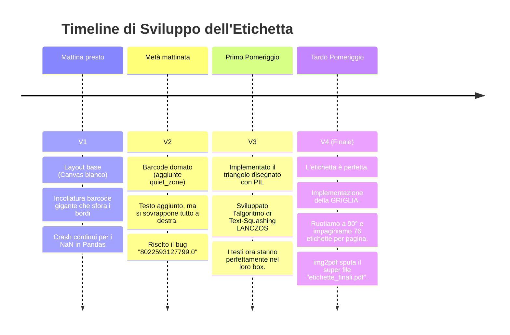

# 📖 Il Diario di Bordo: Progetto Etichette Aziendali (Da Stamattina alla Vittoria!)

## 🎯 1. Il Contesto e l'Obiettivo Iniziale (Ore 09:00)

**Il Nemico/Amico**: Un file Excel chiamato `4_ELENCO_ETICHETTE_AZIENDALE.xlsx` (foglio "Situazione Magazzino").
**Il Contenuto**: 992 righe contenenti `BARCODE` (EAN-13), `CODICE SIGLA`, `MODELLO`, `MATERIALE`, `DIMENSIONI`, e un path di `IMMAGINE`.
**La Missione**:
Creare script Python in grado di macinare questi dati, e sputare fuori delle etichette (inizialmente pensate singole PNG a 300DPI, poi raggruppate in PDF) con un layout preciso e spietato:

1. Un box di sinistra contenente un segnale di avvertimento (Triangolo arancione con punto esclamativo).
2. Un box di destra contenente un codice a barre EAN-13 leggibile (con cifre inferiori).
3. Sotto al barcode: `CODICE SIGLA`, `MODELLO`, `MATERIALE`, e `DIMENSIONI` con stili, grassetti e spaziature precise.
4. _Parametrizzabile_, _Robusto_, a prova di bomba (nessun crash se mancano i dati).

---

## 🧠 2. Brainstorming e Scelte Architetturali

Prima di scrivere codice, abbiamo fatto un lungo brainstorming sulle tecnologie da usare:

### Lettura Excel

- **Pandas vs Openpyxl**: Abbiamo optato per `pandas`. Molto più rapido nel parsare 992 righe rispetto a un parser puramente a celle come openpyxl, specialmente se in futuro il dataset dovesse espandersi a decine di migliaia di righe.

### Disegno dell'Etichetta

- **ReportLab vs Pillow (PIL)**: Potevamo generare direttamente PDF con ReportLab (testo e linee vettoriali). Tuttavia, avevamo bisogno di:
  1. Compressione orizzontale del testo dinamica.
  2. Rendering del barcode scalato a dovere.
  3. Disegno dell'icona di attenzione in modo custom e pixel-perfect.
     Abbiamo quindi scelto la via dell'**immagine raster ad altissima risoluzione (300 DPI)** usando **Pillow (`PIL`)**. Ogni etichetta nasce come una tela bianca (750x373 pixel), su cui "dipingiamo" i vari elementi.

### Generazione Barcode

- Abbiamo scelto `python-barcode`. Sembrava facile, finché non abbiamo scoperto i suoi segreti e limitazioni (vedi "Problemi Affrontati").

### Assemblaggio Finale PDF

- **img2pdf**: Avendo in mano un centinaio (o quasi mille) di PNG in alta risoluzione, incollarle in un documento multipagina tramite un loop in ReportLab era tedioso e pesante per la memoria. Abbiamo quindi usato Pillow per impaginarle a **griglia (19 colonne x 4 righe)** ruotate di 90 gradi per massimizzare lo spazio, e infine dato in pasto le "super-pagine" a `img2pdf` (un pacchetto C-optimized) per fonderle nel colossale `etichette_finali.pdf` da ~62 MB.

---

## 🛠️ 3. I Problemi Affrontati (e come li abbiamo distrutti)

Non è stata una passeggiata. La programmazione reale è fatta di edge-case e dati sporchi.

### 💀 Problema #1: I Barcode "Float" e Invalidi

L'Excel aveva la sgradevole abitudine di restituire i codici a barre come numeri float, tipo `8022593127799.0`. Python-barcode, ovviamente, rigettava questa roba o generava codici errati.
**La Soluzione**: Cast in `str()`, strip(), e un check `.endswith('.0')` per troncare i decimali sporchi. Abbiamo anche aggiunto una guardia: `if len(barcode_val) != 13 or not barcode_val.isdigit()`, permettendo allo script di saltare i barcode rotti con un warning elegante (`print("ATTENZIONE...")`) invece di arrestare brutalmente l'elaborazione al 75%.

### 📏 Problema #2: Il Testo Sbordante (Dynamic Text Squashing)

Il `CODICE SIGLA` e il `MODELLO` a volte erano cortissimi, altre volte lunghi come la Quaresima (es. `00100010ALB0200X0200`). Se usavamo un font-size fisso, i testi lunghi andavano a scrivere sopra il triangolo arancione.
**La Soluzione Magica**: Abbiamo creato la funzione `draw_squashed_text_center`.
Questa funzione:

1. Disegna il testo in grande su un layer invisibile.
2. Misura la larghezza esatta usando `font.getbbox()`.
3. Se sfora la larghezza massima (`max_text_width`), applica uno stretching (ridimensionamento orizzontale) usando l'algoritmo di resampling `Image.Resampling.LANCZOS`, comprimendo il font orizzontalmente come fanno i programmi di grafica professionali, senza abbassare l'altezza!

### 📐 Problema #3: L'icona del Triangolo

Volevamo evitare dipendenze da file PNG esterni per il triangolo di warning (più roba esterna = più probabilità che l'utente dimentichi il file).
**La Soluzione**: L'abbiamo programmata "hardcoded" con trigonometria base in `create_attention_icon()`.
Abbiamo disegnato vettorialmente i 3 vertici del poligono, la riga verticale nera e il puntino, in un layout scalabile dinamicamente.

### 🖼️ Problema #4: Le Immagini di Rete Assenti

L'Excel conteneva path improbabili a percorsi di rete (che non servivano strettamente per l'etichetta base, ma nel codice finale abbiamo implementato la _possibilità_ di inserirli se presenti in locale). Spesso i campi erano `NaN`.
**La Soluzione**: Try-except su tutte le letture. Se un'immagine indicata fallisce il caricamento o non è nella cartella `Immagini_articoli_Sigla`, incolliamo di default l'icona del triangolo arancione.

### 🧩 Problema #5: Il Barcode ribelle e le "Quiet Zones"

Di default, `python-barcode` genera un mare di spazio bianco (quiet zone) attorno alle barre, che rovinava tutto il layout dell'etichetta, facendolo collidere con il testo.
**La Soluzione**: Abbiamo dovuto iniettare delle custom `writer_options`:

```python
writer_options = {
    'dpi': 300,
    'module_width': 0.25,
    'module_height': 6.0,
    'font_size': 7,
    'text_distance': 4.5,
    'guard_height_factor': 1.2,
    'quiet_zone': 2.0, # <--- La chiave della vittoria
    'font_path': 'arial.ttf'
}
```

E abbiamo diviso la stringa testuale EAN-13 per farla stampare esattamente nel formato `X XXXXXX XXXXXX` sotto le barre.

---

## 📈 4. La Timeline dell'Evoluzione (Visualizzata)

Ecco come è mutata la nostra etichetta durante la giornata.



### Mockup Visuali (L'Evoluzione Reale)

Ecco le immagini generate che mostrano la vera evoluzione dell'etichetta durante lo sviluppo:

**V1: Inizio Giornata (Solo Barcode Grezzo e Fuori Scala)**


**V2: Testo Aggiunto (Nessuna formattazione e testi accavallati)**


**V3/V4: Il Layout Prende Forma (Icona vettoriale e Layout a Colonne)**


---

## 🚀 5. L'Architettura del Flusso (WorkFlow Finale)

L'algoritmo definitivo che hai ora in esecuzione funziona così:

1. **Setup**: Pulisce l'output precedente, scansiona cartelle alla ricerca dell'Excel.
2. **Ciclo Iterativo (`df.iterrows()`)**:
   - Estrae riga, pulisce i dati (`.strip()`).
   - Se manca l'immagine locale, usa un try/except che fa il fallback sull'icona generata da noi.
   - Crea un Canvas 750x373 bianco.
   - Disegna Box Sinistra (Icona o Immagine scalata e centrata con `ImageOps.pad`).
   - Genera Barcode EAN-13 temporaneo, lo rimpicciolisce, lo incolla a Destra.
   - Applica `draw_squashed_text_center` 4 volte per i testi (ognuno a un'altezza in % precisa `y_pct` diversa, con scale diverse).
   - Salva la PNG singola.
3. **Mega-Merge**:
   - Conta i file. Divide per `19x4` (colonne x righe).
   - Crea un "Lenzuolo" bianco per ogni pagina.
   - Ruota ogni singola etichetta di 90° (`Image.Transpose.ROTATE_90`) e la incolla a griglia con `gap = 10` e bordi neri.
   - Scrive il PDF master pulendo le tracce temporanee dietro di sé (`shutil.rmtree(temp)`).

## 🎉 Conclusione

Da un'idea e un file excel incasinato, abbiamo forgiato uno strumento di stampa massiva di etichette in grado di gestire errori, impaginare fogli enormi, disegnare asset vettoriali autonomamente e comprimere font.

**Software/Librerie Usate**:

- `Python 3.x`
- `pandas` e `openpyxl` (Gestione Dati Excel)
- `python-barcode` (Gestione Algoritmica EAN-13)
- `Pillow` (Motore grafico raster e manipolazione)
- `img2pdf` (Compilatore PDF ultra-veloce)

Missione Compiuta. 💪
