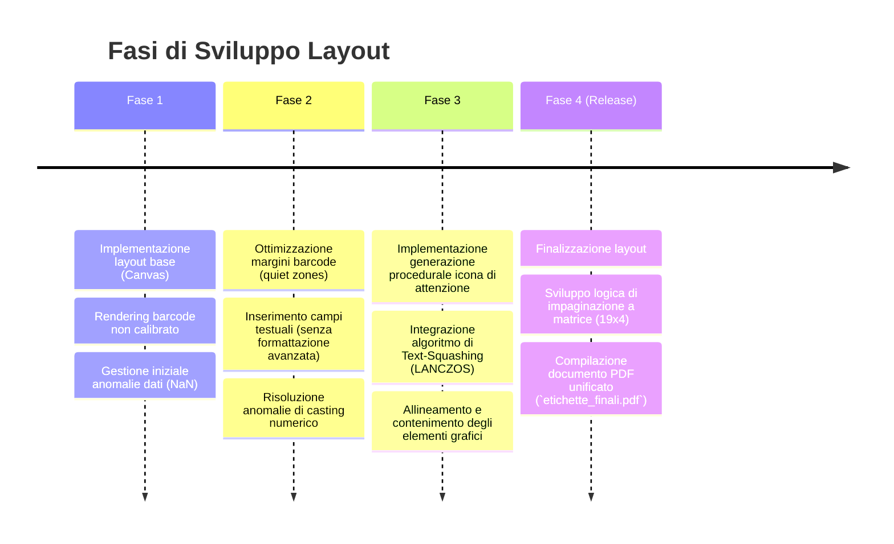

# Relazione Tecnica: Progetto Automazione Etichette Aziendali

## Obiettivo del Progetto
Il progetto ha come scopo l'automazione della generazione di etichette da magazzino, partendo da un'esportazione dati in formato Excel e producendo un file PDF ottimizzato per la stampa massiva.

## 1. Contesto e Requisiti Iniziali

**Origine Dati**: File Excel (`4_ELENCO_ETICHETTE_AZIENDALE.xlsx`, foglio "Situazione Magazzino") composto da circa 1000 righe.
**Campi Elaborati**: `BARCODE` (EAN-13), `CODICE SIGLA`, `MODELLO`, `MATERIALE`, `DIMENSIONI`, e percorso `IMMAGINE`.
**Requisiti Output**: 
Generazione di etichette in formato immagine ad alta risoluzione (300 DPI) e successiva impaginazione in un unico file PDF. Il layout richiesto per ogni etichetta è il seguente:
1. Box sinistro: Segnale di avvertimento (triangolo di attenzione) o immagine prodotto (se disponibile).
2. Box destro: Codice a barre in formato EAN-13, leggibile dai dispositivi ottici, con cifre in chiaro sottostanti.
3. Sezione inferiore: Campi testuali (`CODICE SIGLA`, `MODELLO`, `MATERIALE`, `DIMENSIONI`) con formattazione e spaziature definite.
4. Robustezza: Il sistema deve gestire eventuali anomalie o dati mancanti senza interrompere l'elaborazione.

---

## 2. Architettura e Scelte Tecnologiche

Durante la fase di analisi sono state selezionate le seguenti tecnologie per garantire performance e scalabilità:

### Acquisizione Dati (Excel)
* **Libreria**: `pandas`. 
* **Motivazione**: Efficienza superiore nell'elaborazione massiva di dati tabellari rispetto ad alternative orientate alle celle (es. `openpyxl`), garantendo scalabilità in previsione di un aumento dei volumi di dati.

### Generazione Layout Etichette
* **Libreria**: `Pillow` (PIL).
* **Motivazione**: La necessità di operare un ridimensionamento dinamico del testo, un rendering accurato del barcode e la generazione procedurale di elementi grafici (es. icona di attenzione) ha portato a scartare soluzioni puramente vettoriali in favore di una gestione raster ad alta risoluzione. Ogni etichetta è elaborata come un'immagine (750x373 pixel a 300 DPI).

### Generazione Codici a Barre
* **Libreria**: `python-barcode`.
* **Impiego**: Scelto per la generazione standardizzata di barcode EAN-13, opportunamente configurato per rispettare i vincoli di layout.

### Impaginazione PDF
* **Libreria**: `img2pdf`.
* **Motivazione**: L'aggregazione di un elevato numero di immagini ad alta risoluzione tramite approcci standard risultava inefficiente in termini di memoria. La soluzione implementata prevede l'impaginazione preventiva tramite `Pillow` in matrici da 19x4 (ruotate di 90° per l'ottimizzazione degli spazi) e la successiva conversione in PDF tramite `img2pdf`, garantendo alte prestazioni.

---

## 3. Gestione delle Eccezioni e Ottimizzazioni

Durante lo sviluppo sono state affrontate e risolte diverse criticità legate alla qualità del dato in ingresso e alla resa grafica:

### 3.1 Normalizzazione dei Dati Barcode
* **Criticità**: Presenza di valori formattati come float (es. `8022593127799.0`) nell'export Excel.
* **Soluzione**: Implementazione di routine di sanitizzazione per la conversione in stringa, rimozione di decimali e validazione della lunghezza (13 cifre numeriche). I record non conformi generano un log di avviso (warning) anziché un'interruzione del processo (fatal error).

### 3.2 Adattamento Dinamico del Testo (Text Squashing)
* **Criticità**: Lunghezza variabile dei campi `CODICE SIGLA` e `MODELLO`, con rischio di sovrapposizione ad altri elementi grafici.
* **Soluzione**: Sviluppo della funzione `draw_squashed_text_center`. La routine calcola l'ingombro del testo (`font.getbbox()`) e, in caso di superamento della larghezza massima consentita, applica un ridimensionamento orizzontale interpolato (`Image.Resampling.LANCZOS`), mantenendo inalterata l'altezza del carattere.

### 3.3 Gestione Asset Grafici (Icona di Attenzione)
* **Criticità**: Evitare dipendenze da file di immagine esterni per gli elementi grafici standard.
* **Soluzione**: Generazione procedurale (hardcoded) dell'icona del triangolo di attenzione tramite la funzione `create_attention_icon()`, utilizzando operazioni vettoriali di base per garantire scalabilità e indipendenza da asset locali.

### 3.4 Fallback per Immagini Mancanti
* **Criticità**: Percorsi di rete non validi o file immagine assenti.
* **Soluzione**: Inserimento di blocchi `try-except` per il caricamento delle risorse. In caso di errore o risorsa non trovata, il sistema adotta automaticamente l'icona di attenzione come fallback visivo.

### 3.5 Calibrazione del Codice a Barre (Quiet Zones)
* **Criticità**: Spaziature di default (quiet zones) della libreria `python-barcode` incompatibili con il layout richiesto.
* **Soluzione**: Overriding dei parametri di rendering:
```python
writer_options = {
    'dpi': 300,
    'module_width': 0.25,
    'module_height': 6.0,
    'font_size': 7,
    'text_distance': 4.5,
    'guard_height_factor': 1.2,
    'quiet_zone': 2.0, 
    'font_path': 'arial.ttf'
}
```

---

## 4. Evoluzione del Layout (Timeline)

Il processo di sviluppo del layout dell'etichetta si è articolato nelle seguenti fasi:



### Documentazione Visiva dello Sviluppo

**Fase 1: Implementazione Iniziale**


**Fase 2: Integrazione Testuale Preliminare**


**Fase 3/4: Layout Definitivo**


---

## 5. Architettura del Flusso Esecutivo (Workflow)

Il processo automatizzato si compone delle seguenti fasi sequenziali:

1. **Inizializzazione**: Bonifica delle directory temporanee e individuazione del file Excel sorgente.
2. **Ciclo di Elaborazione (`df.iterrows()`)**: 
   - Estrazione e sanitizzazione della riga dati.
   - Gestione caricamento immagine con fallback automatico su icona procedurale.
   - Inizializzazione del canvas grafico (750x373px).
   - Rendering sezioni sinistra (immagine/icona, ottimizzata tramite `ImageOps.pad`) e destra (codice EAN-13 ridimensionato).
   - Compilazione dei campi testuali tramite `draw_squashed_text_center` con parametri di posizionamento relativi e scaling differenziati.
   - Esportazione temporanea in formato PNG.
3. **Fase di Aggregazione (Merge)**:
   - Calcolo della distribuzione delle etichette (matrice 19 colonne x 4 righe).
   - Generazione dei fogli (canvas master).
   - Rotazione (`ROTATE_90`) e impaginazione progressiva delle singole etichette con margini predefiniti (gap = 10px).
   - Compilazione finale del documento PDF (`etichette_finali.pdf`) e successiva rimozione dei file temporanei.

## Riepilogo Stack Tecnologico

- **Linguaggio**: `Python 3.x`
- **Data Manipulation**: `pandas`, `openpyxl`
- **Generazione Barcode**: `python-barcode`
- **Elaborazione Immagini**: `Pillow`
- **Generazione PDF**: `img2pdf`

